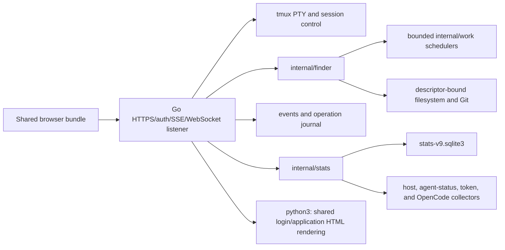

# YOmux Go Backend Status

This document records the Go backend capabilities implemented in this tree and owns the migration inventory. Go is the target backend and the default server for managed/operator launches, including `boot.sh`, `make run`, and `yomux-dev-start`. Python is a deprecated temporary fallback. Every currently supported Python-only product behavior must be ported to Go before Python removal; it must not disappear just because its old server is removed. The removal gate also includes the shared HTML renderer, runtime dependencies, contributor/build tooling, and companion tools that still require Python. The current late-October 2026 removal date is a target, conditional on closing this inventory and proving the Go-only build and runtime path. Go exposes only the capabilities and routes it owns; unsupported behavior stays unavailable until its Go owner is implemented.

## Migration Rule

Treat each Python-only product feature as a Go migration gap unless the user explicitly decides to retire that feature. Track its Go owner, capability, route, tests, and user-facing behavior here or in one linked active work queue. Python may remain during migration, but it receives no new product behavior. The final Python-removal gate must show that supported user-facing behavior, runtime entrypoints, required tooling, the HTML renderer, and companion utilities no longer depend on Python.

## Launch And Backend Selection

Managed launchers select Go by default. `yomux-dev-start` passes `--backend go` explicitly. To run the deprecated Python server, opt in explicitly:

```bash
./boot.sh --deprecated-python 7221
```

Build, validate, and start a Go instance with:

```bash
make setup
tools/build_go.sh
tools/run_bazel_tests.sh --jobs "$(getconf _NPROCESSORS_ONLN)"
./boot.sh 7221
```

`boot.sh` finds the canonical Bazel output at `bazel-bin/cmd/yomux-go/yomux-go_/yomux-go`, applies shared startup and port ownership checks without a CPU, memory, or OS load-average gate, invokes `python3 yomux.py --backend go`, and then the Python CLI replaces itself with the Go process while carrying host, port, checkout root, and environment-selected config/state. `--golang` and `--backend go` remain aliases. `--backend python` is rejected by managed `boot.sh`; use `--deprecated-python`. Managed startup binds `0.0.0.0` by default. Direct execution of the Go binary defaults to `127.0.0.1`, so use the launcher for operator runs. Direct `python3 yomux.py` also selects Go unless `--backend python` is explicit.

A Go process launched by an older managed launcher may not hold the shared root and port leases. Gracefully stop that verified listener once before migrating it; new managed Go processes retain those leases across `exec`, so later `boot.sh --force <port>` restarts can replace them safely.

Go owns TLS after the `exec`: by default it generates a self-signed certificate with Go's crypto library under `${TMPDIR:-/tmp}/yomux-go-tls-<port>/`. The managed Python launcher forwards `--http`, `--cert`, and `--key`, and maps `--dang` to Go's `--dangerously-yolo`. Python-only `--sessions`, transcript-report, runtime-report, and `--dev` options return a clear error on Go. The Go binary also accepts its own `--cert`, `--key`, `--http`, and `--dangerously-yolo` flags for fixture/direct use, but a direct launch does not replace `boot.sh` lifecycle and isolation checks.
All operator launch forms use the machine-wide default tmux server for the launching Unix user. Managed launchers remove inherited `TMUX`, `TMUX_PANE`, and `YOMUX_TMUX_SOCKET` routing before starting Python or Go, so `tmux list-sessions` and the Go/Python session APIs see every session on that server. Direct Python, Go, and companion-tool entrypoints apply the same normalization for ordinary launches; an explicit `YOMUX_TMUX_SOCKET` is preserved only when an isolated test or fixture deliberately supplies it. A different Unix user's tmux server is not implicitly accessible.

The Go server still requires Python runtime dependencies and this checkout's generated static assets. It invokes `python3` to render `login_html()` and `html_page()` from `yomux_lib.web`; replacing this renderer is required for the final Go-only runtime.

Automated tests must not use an operator port. `tools/run_bazel_tests.sh` starts disposable Docker state and fixture-owned ports. Port 7221 is reserved for a final manual check after the Dockerized gate. The operator runtime on port 7220 is outside automated test workflows and should only be restarted or smoke-tested as an explicit operator action.

## Architecture Decision

The Go backend is a modular monolith. It does not reproduce Python's web-process-plus-six-local-services topology.



One `yomux-go` process owns:

* HTTPS, TLS, authentication, static files, and the shared application bootstrap.

* tmux discovery, session creation and deletion, PTY/WebSocket terminal I/O, and terminal status paths that have registered handlers.

* An SSE event broker, durable accepted-operation journal, terminal operation events, acknowledgements, cancellation, and repair after restart.

* Finder and Differ routes, descriptor-bound filesystem access, Git subprocesses, watches, uploads, previews, and bounded in-process schedulers.

* YO!stats SQLite writing/reading, snapshots/deltas/SSE, materialization, bounded rings, pricing, host metrics, agent status, transcript tokens, and OpenCode ingestion.

The Go process does not start or talk to Python `statsd`, `indexd`, `batchd`, `statusd`, `watchd`, or `approvald`. Those names describe the Python backend only.

## Source Ownership

| Owner | Responsibility |
| --- | --- |
| `cmd/yomux-go/main.go` | Listener, TLS/auth, tmux PTY/WebSocket, core routes, event broker, operation journal, diagnostics, Python HTML rendering, startup, and shutdown |
| `cmd/yomux-go/finder_jobs.go` | Bounded interactive, background, bulk, and streaming Finder admission and operation completion |
| `cmd/yomux-go/differ_routes.go` | Session-file request identity, persistent cache, Git-backed Differ data, and cache refresh |
| `cmd/yomux-go/stats_runtime.go` | YO!stats route adapters, runtime collectors, migration, snapshots, deltas, streams, pricing, readiness, and diagnostics |
| `internal/capabilities` | One capability catalog used by bootstrap, route admission, and diagnostics |
| `internal/finder` | Descriptor-bound filesystem access, listing, read/raw/info, watch, search, Git diff/history/commit/blame, mutations, upload, archive, and HTML preview |
| `internal/stats` | SQLite writer/readers, schema, observations, snapshots, rings, lifecycle materialization, host collection, agent status, token collection, pricing, and OpenCode |
| `internal/work` | Bounded worker/queue scheduler used inside the Go process |
| `static_src/` and `static/` | Shared browser source and generated bundle used by both backends |
| `yomux_lib.web` | Shared HTML/login renderer currently invoked by both launch modes |

## Capability Contract

`GET /api/capabilities` is the browser's feature-admission source. A capability is not proof that every Python route in that family exists; the registered handler list below remains authoritative for route availability.

The current catalog marks these capabilities available:

* `core.bootstrap.v1`, `core.diagnostics.v1`

* `terminal.websocket.v1`, `terminal.tmux.v1`, `terminal.status.v1`

* `session.roster.v1`, `session.create.v1`, `session.kill.v1`, `session.rename.v1`

* `pane.finder.v1`, `pane.differ.v1`, `pane.stats.v1`, `pane.tabber.v1`

* `finder.read.v1`, `finder.watch.v1`, `finder.write.v1`, `finder.search.v1`, `finder.batch.v1`, `finder.git.v1`, `finder.preview.v1`

* `yolo.auto-approve.v1`

The current catalog marks these pane capabilities unavailable:

* `pane.chat.v1`

* `pane.agent.v1`

Any unregistered `/api/*` request receives HTTP `501` with `error: feature_unavailable` and the mapped capability name. Unsupported product code must not silently return an empty Python-shaped payload.

## Registered Go Routes

The following routes have concrete handlers in `cmd/yomux-go`.

### Core, Authentication, Events, And Operations

* `/healthz`, `/livez`, authenticated `/readyz`

* `/login`, `/logout`, `/api/auth-setup`

* `/`, `/static/*`, `/api/ping`, `/api/capabilities`

* `/api/client-events`, `/api/event`

* `/api/operations/{id}`, `/api/operations/ack`, `/api/operations/cancel`, `/api/operations/accept`, `/api/operations/terminalize`

* `/api/background/status`, `/api/background/claim`

* `/api/system-status`, `/api/system-status/advanced`, `/api/logs`

### Terminal And Sessions

* `/ws`, `/api/tmux`, `/api/tmux-signals`, `/api/tmux-session-exists`

* `/api/session-metadata`, `/api/activity`

* `POST /api/attention-ack`

* `/api/ensure-session`, `/api/create-session-plan`, `/api/create-session`, `/api/rename-session`, `/api/kill-session`

* `/api/transcripts`, `/api/transcript`, `/api/context`, `/api/context-items`, `/api/context-stream`

* `/api/auto-approve`, `/api/yolo-rules`, `/api/yolo-rules/open`, `/api/yolo-rules/reload`

The shared browser must capability-gate other Python terminal/session paths. Go publishes per-window completion timestamps and transition identities through session metadata and Tabber activity; `POST /api/attention-ack` stores bounded acknowledgements and publishes `attention_acks_changed` so other tabs converge. `yolo.auto-approve.v1` owns the authenticated per-session toggle and status route. Its worker uses the shared Python/Go target lock, pins tmux session and pane identity plus the live agent process, and suspends when fresh status or terminal evidence is unavailable. It applies the configured `approve`, `decline`, `block`, `ask`, `notify`, and `off` actions to supported Claude and Codex prompts, honors `yolo.dry_run`, and retries only the exact current Codex capacity notice with `continue\n\n` at a minimum three-second interval. Self-update uses the `core.updates.v1` capability; YO!agent remains unavailable in Go. Go's Tabber activity route is admitted by the machine-wide tmux roster, so every live session gets one top-level row before pane metadata or agent enrichment arrives. Transcript routes accept an optional `pane_target` or `window`; without either, Go resolves the active tmux pane. This prevents a session containing multiple Claude, Codex, or OpenCode windows from returning the first unrelated transcript.

### Finder, Editor, And Differ

* `/api/fs/fast/list`, `/api/fs/list`, `/api/fs/read`, `/api/fs/info`, `/api/fs/raw`

* `/api/fs/write`, `/api/fs/delete`, `/api/fs/rename`, `/api/fs/mkdir`, `/api/upload`

* `/api/fs/search`, `/api/fs/search-stream`, `/api/fs/index-status`, `/api/fs/unindex`

* `/api/fs/watch-diff`, `/api/watch/roots`

* `/api/fs/batch`, `/api/fs/resolve-file-candidates`

* `/api/fs/diff`, `/api/fs/git-history`, `/api/fs/git-history-stats-stream`, `/api/fs/git-commit`

* `/api/batch/search`, `/api/batch/blame`, `/api/batch/zip`, `/api/batch/count`, `/api/batch/html-preview`

* `/api/session-files`, `/api/session-files-stream`, `/api/session-files-batch`

TextEdit and ViewEdit use the shared browser implementation and these Finder read/write/raw/upload/preview routes. There is no separate Go editor daemon or editor capability family.

Go Finder accepts any absolute path the process can access. It does not apply Python's configured-root allowlist or credential-name denylist. The security boundary is OS permission plus descriptor identity, bounded reads/walks/results, authorization role, and the protected product-root mutation guard. Symlink and namespace-sensitive operations revalidate descriptor identities before use; the implementation documents the remaining same-UID basename race where the operating system lacks a conditional namespace syscall.

Finder's fast path lists names without optional repository enrichment. The browser can paint the first directory immediately, then request or receive slower Git/status data. Differ history follows the same split: commit rows can load without `+N/-N`, and `stats=1` backfills numstat counts. Commit expansion uses one bounded Git detail path for metadata, file status/counts, and diff content rather than issuing one Git process per field.

### YO!stats

Tabber's Go API is separate from YO!stats storage: `/api/activity?scope=all` returns the global tmux session order plus live pane/window metadata and activity fields consumed by the shared Tabber tree. The Go command boundary clears inherited nested-tmux variables for this machine-wide read; tests use `YOMUX_TMUX_SOCKET` with synthetic sessions when isolation is required.

* `/api/stats-agent-status`, `/api/stats-capabilities`

* `/api/stats-observations`, `/api/stats-snapshot`, `/api/stats-delta`, `/api/stats-stream`

* `/api/pricing-catalog`

The Go process opens `stats-v9.sqlite3` directly and owns its writer lock. It does not use the Python statsd RPC protocol. The current storage, wire, and parity gaps are listed in this guide's YO!stats section and current-gaps list.

When the Go token collector enables database checkpoints, it upgrades that same file to schema 10 with minimum writer protocol 26. The filename stays unchanged. Parser progress, exact comparison bytes, and scheduling metadata share the writer transaction with usage facts and tombstones; a checkpoint-only update does not change graph source generation. A bare writer without token collection can still use schema 9 for interoperability fixtures. Unchanged Python cannot write the migrated database.

Before upgrading, Go holds the database writer lease and legacy cursor locks, makes a consistent SQLite backup, and copies the paired cursor files and writer fence into an adjacent `<database>.pre-checkpoints-*` directory. `cursor-manifest.json` maps original paths to backup files. The `go-checkpoints-v1` row in `migration_reconciliation` records the backup directory in `source_digest`. Pending legacy cursor work is replayed from committed progress.

To roll back, stop the Go owner first. Preserve the migrated database, its WAL/SHM sidecars, current writer fence, and current cursor files in a separate recovery directory. Restore the backed-up database and every file listed in its cursor manifest to their original paths before starting Python. Do not leave migrated WAL/SHM files beside the restored database. Retain both backup sets so rollback does not discard newer facts.

## Completed Delivery Slices

| Slice | Current result |
| --- | --- |
| Phase 0 | Bazel/rules_go build, Docker test image, contract fixtures, capability/bootstrap contract, and isolated launch path |
| Phase 1 | TLS/authenticated Go skeleton, shared HTML/bootstrap, tmux discovery, and first PTY/WebSocket path |
| Phase 2 | Terminal/session behavior, role checks, lifecycle, resize/input/output, and browser contract completion for the supported terminal path |
| Phase 3 | SSE events, accepted-operation receipts, durable journal/restart repair, diagnostics, and background status ownership |
| Phase 4/5 | Finder read/write/watch/search/batch/upload/preview and arbitrary absolute-path support with descriptor-bound safety |
| Phase 6/7 | Shared TextEdit/ViewEdit exercised through Go Finder APIs, including save, upload, preview, and Chromium editor workflows |
| YO!stats | Go SQLite ownership, snapshots/deltas/SSE, collectors/materialization/rings, pricing, agent status, tokens, OpenCode, and Docker browser coverage |
| Phase 8 | Differ session-file caches, quick history followed by numstat backfill, consolidated commit detail, diff, history, commit, and blame routes |

The transcript compatibility routes remain distinct wire contracts. Their current Go behavior is owned by the registered route handlers and tests; no separate consolidation queue is active.

Phase numbers are migration history, not runtime configuration. The capability catalog and registered routes determine current behavior.

## API And Async Contracts

The Go backend preserves the shared response and async rules:

* Auth and role checks run before route work.

* Immediate work returns a terminal response envelope.

* Accepted work receives a durable operation id and must publish exactly one terminal completion or failure.

* Operation acknowledgements are persisted and pruned within bounds.

* Request cancellation does not cancel work after the server has returned an accepted receipt; explicit operation cancellation owns that transition.

* Events and operations survive bounded restart repair through `go-events.jsonl`, `go-operations.json`, and `go-operations.jsonl` under the selected private state/config root.

* Unknown or unavailable routes return typed failures instead of HTTP 200 with embedded error text.

The Go service uses separate bounded schedulers for interactive Finder work, background refresh, bulk work, and streamed search. Queue saturation returns a typed busy failure. It does not create Python `batchd` workers or rely on a cross-process queue.

## Build And Test Contract

The canonical full host gate is:

```bash
python3 tools/check.py
```

Its default `bazel-go` lane invokes the standalone Go wrapper below. Run the wrapper directly for focused Go validation; do not run it after a successful full gate against the same frozen tree merely to repeat the suite.

```bash
tools/run_bazel_tests.sh --jobs "$(getconf _NPROCESSORS_ONLN)"
```

The wrapper accepts an optional positive integer `--jobs`; when the flag is omitted it computes the host CPU count. On the host it launches `docker/run-tests.sh`, mounts source read-only, creates private Bazel output/cache/GOPATH/GOCACHE roots, disables downloads and network access for test execution, and removes the invocation-owned writable root afterward. Parallel invocations use different temporary roots and fixture-owned ports.

`//:go_tests` includes:

* Go unit suites for the server, capabilities, Finder, stats, fake LLM, and scheduler.

* Race-enabled Go suites for those owners.

* Go binary/API contract and Bazel action-environment tests.

* Docker runtime contract coverage.

* Dockerized Chromium Finder/editor/Differ end-to-end coverage.

* Dockerized Chromium YO!stats coverage.

* Dockerized agent-status integration coverage.

`python3 tools/check.py` covers Python, the shared frontend, and the Dockerized Go suite once. A fixed live port is a manual smoke target only and cannot replace that gate.

## Remaining Gaps

* YO!chat and YO!agent remain Python-only and must be ported to Go before Python removal; Go now serves the global tmux roster/activity API used by Tabber.

* Go update detection and managed self-update now use root `version.yaml`, the `core.updates.v1` capability, cached `/api/update-status`, persistent `/api/self-update/status`, and `boot.sh` for selected-instance replacement. The installer refuses dirty, diverged, or changed checkouts and prepares the pinned binary and browser assets before activation. Native Darwin qualification remains a release acceptance step.

* Go HTML rendering still depends on a Python subprocess and Python package environment; both are removal blockers.

* Go credential admission is durable and shared across form, Basic API, and WebSocket paths. Network reservations, successful refunds, username cooldowns, hard locks, HMAC identifiers, and bounded in-flight claims live in a separate state-rooted SQLite store. Go accepts the documented policy override keys; the Python recovery CLI, throttle diagnostics, decoy, and firewall escalation remain unavailable and need explicit Go migration dispositions before Python removal.

* Go consumes `YOMUX_CONFIG_DIR`, `YOMUX_STATE_DIR`, `YOMUX_ROOT`, and `YOMUX_STATS_DATABASE`, and admits its config/journal directory and auth/stats WAL stores only on supported local filesystems unless the explicit emergency override is set. Go does not implement Python's `YOMUX_RUNTIME_DIR`/`YOMUX_CACHE_DIR` service topology or automatic host partition. Event/operation journals, cookie auth material, background-owner records, and the default stats database remain config-rooted; the session-files cache and credential-admission database use the state root. A canonical config lifetime lease prevents independent event brokers from sharing those journals. Use the managed launcher so each preview gets private local roots.

* Go YO!stats owns its storage and collectors in process; it does not implement the legacy Python statsd RPC/lifecycle topology. Keep both backends on isolated roots while comparing them.

* Go stores Claude/Codex transcript and OpenCode parser progress in versioned checkpoints in the YO!stats database. Migration imports legacy cursor sidecars and pairs them with a database backup; unchanged Python may reject schema 10. The broader Python-versus-Go recovery and output comparison remains incomplete.

* Runtime agent/OpenCode discovery currently uses Linux adapters. Cross-platform parity is not established.

* Exact cross-backend output comparison, long-history migration evidence, and production-scale performance evidence remain incomplete.

* The Go build/test/runtime path is Linux-first. Docker is the required certification environment for current Chromium and race coverage.

## Rollout Rules

1. Build the exact worktree with Bazel.

2. Run the complete Dockerized Bazel suite with fixture-owned state and ports.

3. Fix product failures; do not hide them with retries, sleeps, lower concurrency, or a live-port substitution.

4. Start an explicit non-production preview port through `boot.sh` only after automated checks.

5. Verify the listener, `/healthz`, capability snapshot, and exact browser workflow against the rebuilt bundle.

6. Keep the deprecated Python server as an explicit temporary fallback while Go migration work continues. Remove it only after the supported-feature inventory is closed, every Python runtime/build/tool dependency is replaced or eliminated, and the exact Go-only gate and browser journeys pass; late October 2026 remains the target, not permission to drop open behavior.

## Related Documents

* [`README.md`](README.md): operator quickstart and dual-backend overview.

* [`docs/DEVELOPMENT.md`](docs/DEVELOPMENT.md): prerequisites, source layout, build, tests, and restart commands.

* [`docs/specs/BACKEND_ARCHITECTURE.md`](docs/specs/BACKEND_ARCHITECTURE.md): concise Python and Go process ownership overview.

* [`docs/specs/GUI.md`](docs/specs/GUI.md): shared user-interface behavior and verification rules.
