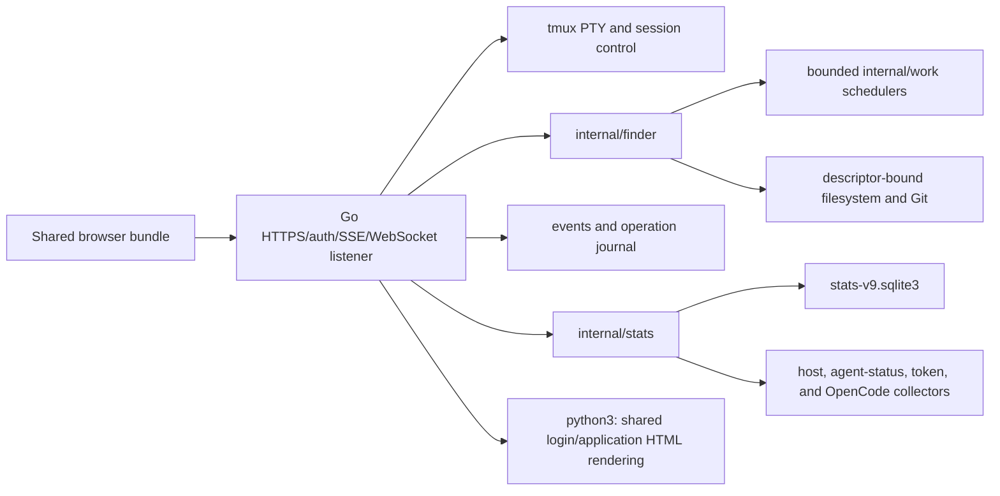

# YOLOmux Go Backend Status

This document describes the experimental Go backend as implemented in the current tree. It replaces the earlier phase proposal. Python remains the default and complete-feature backend; Go is selected explicitly and exposes only the capabilities and routes it owns.

## Launch And Backend Selection

The Python launch is unchanged:

```bash
python3 yolomux.py --dang
```

Build, validate, and start the Go preview with:

```bash
make setup
bazel --bazelrc=/dev/null build --jobs=auto //cmd/yolomux-go:yolomux_go
tools/run_bazel_tests.sh --jobs "$(getconf _NPROCESSORS_ONLN)"
YOLOMUX_START_LOAD_WAIT_SECONDS=30 ./boot.sh --golang 7221
```

`boot.sh --golang` is equivalent to `boot.sh --backend go`. It finds the canonical Bazel output at `bazel-bin/cmd/yolomux-go/yolomux_go_/yolomux_go`, applies the shared startup/load/port lifecycle, invokes `python3 yolomux.py --backend go`, and then the Python CLI replaces itself with the Go process while carrying host, port, checkout root, and environment-selected config/state. Managed startup binds `0.0.0.0` by default. Direct execution of the Go binary defaults to `127.0.0.1`, so use the launcher for operator runs.

Go owns TLS after the `exec`: by default it generates a self-signed certificate with Go's crypto library under `${TMPDIR:-/tmp}/yolomux-go-tls-<port>/`. The current Python launcher path does not forward Python `--cert`, `--key`, `--http`, `--dev`, or `--dang` behavior into Go. The Go binary accepts its own `--cert`, `--key`, and `--http` flags for fixture/direct use, but a direct launch does not replace `boot.sh` lifecycle and isolation checks.

The Go server still requires Python runtime dependencies and this checkout's generated static assets. It invokes `python3` to render `login_html()` and `html_page()` from `yolomux_lib.web`; it does not contain a second HTML shell.

Automated tests must not use an operator port. `tools/run_bazel_tests.sh` starts disposable Docker state and fixture-owned ports. Port 7221 is reserved for a final manual check after the Dockerized gate; port 7220 is outside this preview workflow.

## Architecture Decision

The Go backend is a modular monolith. It does not reproduce Python's web-process-plus-six-local-services topology.



One `yolomux-go` process owns:

- HTTPS, TLS, authentication, static files, and the shared application bootstrap.
- tmux discovery, session creation and deletion, PTY/WebSocket terminal I/O, and terminal status paths that have registered handlers.
- An SSE event broker, durable accepted-operation journal, terminal operation events, acknowledgements, cancellation, and repair after restart.
- Finder and Differ routes, descriptor-bound filesystem access, Git subprocesses, watches, uploads, previews, and bounded in-process schedulers.
- YO!stats SQLite writing/reading, snapshots/deltas/SSE, materialization, bounded rings, pricing, host metrics, agent status, transcript tokens, and OpenCode ingestion.

The Go process does not start or talk to Python `statsd`, `indexd`, `batchd`, `statusd`, `watchd`, or `approvald`. Those names describe the Python backend only.

## Source Ownership

| Owner | Responsibility |
| --- | --- |
| `cmd/yolomux-go/main.go` | Listener, TLS/auth, tmux PTY/WebSocket, core routes, event broker, operation journal, diagnostics, Python HTML rendering, startup, and shutdown |
| `cmd/yolomux-go/finder_jobs.go` | Bounded interactive, background, bulk, and streaming Finder admission and operation completion |
| `cmd/yolomux-go/differ_routes.go` | Session-file request identity, persistent cache, Git-backed Differ data, and cache refresh |
| `cmd/yolomux-go/stats_runtime.go` | YO!stats route adapters, runtime collectors, migration, snapshots, deltas, streams, pricing, readiness, and diagnostics |
| `internal/capabilities` | One capability catalog used by bootstrap, route admission, and diagnostics |
| `internal/finder` | Descriptor-bound filesystem access, listing, read/raw/info, watch, search, Git diff/history/commit/blame, mutations, upload, archive, and HTML preview |
| `internal/stats` | SQLite writer/readers, schema, observations, snapshots, rings, lifecycle materialization, host collection, agent status, token collection, pricing, and OpenCode |
| `internal/work` | Bounded worker/queue scheduler used inside the Go process |
| `static_src/` and `static/` | Shared browser source and generated bundle used by both backends |
| `yolomux_lib.web` | Shared HTML/login renderer currently invoked by both launch modes |

## Capability Contract

`GET /api/capabilities` is the browser's feature-admission source. A capability is not proof that every Python route in that family exists; the registered handler list below remains authoritative for route availability.

The current catalog marks these capabilities available:

- `core.bootstrap.v1`, `core.diagnostics.v1`
- `terminal.websocket.v1`, `terminal.tmux.v1`, `terminal.status.v1`
- `session.roster.v1`, `session.create.v1`, `session.kill.v1`, `session.rename.v1`
- `pane.finder.v1`, `pane.differ.v1`, `pane.stats.v1`
- `finder.read.v1`, `finder.watch.v1`, `finder.write.v1`, `finder.search.v1`, `finder.batch.v1`, `finder.git.v1`, `finder.preview.v1`

The current catalog marks these pane capabilities unavailable:

- `pane.tabber.v1`
- `pane.chat.v1`
- `pane.agent.v1`

There is one known catalog/handler mismatch: `session.rename.v1` is marked available, but the Go server does not register `/api/rename-session`. A stale client reaches the generic typed `501 feature_unavailable` handler. Until the implementation or catalog is corrected, documentation and UI code must not claim that Go session rename works.

Any unregistered `/api/*` request receives HTTP `501` with `error: feature_unavailable` and the mapped capability name. Unsupported product code must not silently return an empty Python-shaped payload.

## Registered Go Routes

The following routes have concrete handlers in `cmd/yolomux-go`.

### Core, Authentication, Events, And Operations

- `/healthz`, `/livez`, authenticated `/readyz`
- `/login`, `/logout`, `/api/auth-setup`
- `/`, `/static/*`, `/api/ping`, `/api/capabilities`
- `/api/client-events`, `/api/event`
- `/api/operations/{id}`, `/api/operations/ack`, `/api/operations/cancel`, `/api/operations/accept`, `/api/operations/terminalize`
- `/api/background/status`, `/api/background/claim`
- `/api/system-status`, `/api/system-status/advanced`, `/api/logs`

### Terminal And Sessions

- `/ws`, `/api/tmux`, `/api/tmux-session-exists`
- `/api/ensure-session`, `/api/create-session-plan`, `/api/create-session`, `/api/kill-session`

The shared browser must capability-gate other Python terminal/session paths. Auto-approval, transcript/activity APIs, self-update, and YO!agent are not made available merely because the terminal itself works.

### Finder, Editor, And Differ

- `/api/fs/fast/list`, `/api/fs/list`, `/api/fs/read`, `/api/fs/info`, `/api/fs/raw`
- `/api/fs/write`, `/api/fs/delete`, `/api/fs/rename`, `/api/fs/mkdir`, `/api/upload`
- `/api/fs/search`, `/api/fs/search-stream`, `/api/fs/index-status`, `/api/fs/unindex`
- `/api/fs/watch-diff`, `/api/watch/roots`
- `/api/fs/batch`, `/api/fs/resolve-file-candidates`
- `/api/fs/diff`, `/api/fs/git-history`, `/api/fs/git-commit`
- `/api/batch/search`, `/api/batch/blame`, `/api/batch/zip`, `/api/batch/count`, `/api/batch/html-preview`
- `/api/session-files`, `/api/session-files-batch`

TextEdit and ViewEdit use the shared browser implementation and these Finder read/write/raw/upload/preview routes. There is no separate Go editor daemon or editor capability family.

Go Finder accepts any absolute path the process can access. It does not apply Python's configured-root allowlist or credential-name denylist. The security boundary is OS permission plus descriptor identity, bounded reads/walks/results, authorization role, and the protected product-root mutation guard. Symlink and namespace-sensitive operations revalidate descriptor identities before use; the implementation documents the remaining same-UID basename race where the operating system lacks a conditional namespace syscall.

Finder's fast path lists names without optional repository enrichment. The browser can paint the first directory immediately, then request or receive slower Git/status data. Differ history follows the same split: commit rows can load without `+N/-N`, and `stats=1` backfills numstat counts. Commit expansion uses one bounded Git detail path for metadata, file status/counts, and diff content rather than issuing one Git process per field.

### YO!stats

- `/api/stats-agent-status`, `/api/stats-capabilities`
- `/api/stats-observations`, `/api/stats-snapshot`, `/api/stats-delta`, `/api/stats-stream`
- `/api/pricing-catalog`

The Go process opens `stats-v9.sqlite3` directly and owns its writer lock. It does not use the Python statsd RPC protocol. See [`GO_MIGRATION_YOSTATS.md`](GO_MIGRATION_YOSTATS.md) and [`docs/specs/STATS_API.md`](docs/specs/STATS_API.md) for the storage/wire split and remaining parity gaps.

## Completed Delivery Slices

| Slice | Current result |
| --- | --- |
| Phase 0 | Bazel/rules_go build, Docker test image, contract fixtures, capability/bootstrap contract, and isolated launch path |
| Phase 1 | TLS/authenticated Go skeleton, shared HTML/bootstrap, tmux discovery, and first PTY/WebSocket path |
| Phase 2 | Terminal/session behavior, role checks, lifecycle, resize/input/output, and browser contract completion for the supported terminal path |
| Phase 3 | SSE events, accepted-operation receipts, durable journal/restart repair, diagnostics, and background status ownership |
| Phase 4/5 | Finder read/write/watch/search/batch/upload/preview and arbitrary absolute-path support with descriptor-bound safety |
| Phase 6/7 | Shared TextEdit/ViewEdit exercised through Go Finder APIs, including save, upload, preview, and Chromium editor workflows |
| YO!stats | Go SQLite ownership, snapshots/deltas/SSE, collectors/materialization/rings, pricing, agent status, tokens, OpenCode, and Docker browser coverage |
| Phase 8 | Differ session-file caches, quick history followed by numstat backfill, consolidated commit detail, diff, history, commit, and blame routes |

Phase numbers are migration history, not runtime configuration. The capability catalog and registered routes determine current behavior.

## API And Async Contracts

The Go backend preserves the shared response and async rules:

- Auth and role checks run before route work.
- Immediate work returns a terminal response envelope.
- Accepted work receives a durable operation id and must publish exactly one terminal completion or failure.
- Operation acknowledgements are persisted and pruned within bounds.
- Request cancellation does not cancel work after the server has returned an accepted receipt; explicit operation cancellation owns that transition.
- Events and operations survive bounded restart repair through `go-events.jsonl`, `go-operations.json`, and `go-operations.jsonl` under the selected private state/config root.
- Unknown or unavailable routes return typed failures instead of HTTP 200 with embedded error text.

The Go service uses separate bounded schedulers for interactive Finder work, background refresh, bulk work, and streamed search. Queue saturation returns a typed busy failure. It does not create Python `batchd` workers or rely on a cross-process queue.

## Build And Test Contract

The canonical full host gate is:

```bash
python3 tools/check.py
```

Its default `bazel-go` lane invokes the standalone Go wrapper below. Run the wrapper directly for focused Go validation; do not run it after a successful full gate against the same frozen tree merely to repeat the suite.

```bash
tools/run_bazel_tests.sh --jobs "$(getconf _NPROCESSORS_ONLN)"
```

The wrapper accepts an optional positive integer `--jobs`; when the flag is omitted it computes the host CPU count. On the host it launches `docker/run-tests.sh`, mounts source read-only, creates private Bazel output/cache/GOPATH/GOCACHE roots, disables downloads and network access for test execution, and removes the invocation-owned writable root afterward. Parallel invocations use different temporary roots and fixture-owned ports.

`//:go_tests` includes:

- Go unit suites for the server, capabilities, Finder, stats, fake LLM, and scheduler.
- Race-enabled Go suites for those owners.
- Go binary/API contract and Bazel action-environment tests.
- Docker runtime contract coverage.
- Dockerized Chromium Finder/editor/Differ end-to-end coverage.
- Dockerized Chromium YO!stats coverage.
- Dockerized agent-status integration coverage.

`python3 tools/check.py` covers Python, the shared frontend, and the Dockerized Go suite once. A fixed live port is a manual smoke target only and cannot replace that gate.

## Remaining Gaps

- Tabber, YO!chat, and YO!agent remain Python-only.
- The Go catalog currently overstates session rename, as described above.
- Python self-update/restart and several Python diagnostic/automation routes are not implemented in Go.
- Go HTML rendering still depends on a Python subprocess and Python package environment.
- Authentication storage and throttling are not at Python parity. Go reads the shared `auth.yaml` format and enforces route roles, but its browser-form limiter is an in-memory five-failure window keyed by socket peer and username; it is not durable or shared across ports, and Go HTTP Basic authentication does not pass through that limiter. Keep the preview behind a trusted network boundary.
- Go consumes `YOLOMUX_CONFIG_DIR`, `YOLOMUX_STATE_DIR`, `YOLOMUX_ROOT`, and `YOLOMUX_STATS_DATABASE`, but it does not implement Python's `YOLOMUX_RUNTIME_DIR`/`YOLOMUX_CACHE_DIR` service topology or root-policy validation. Event/operation journals, auth material, background-owner records, and the default stats database are config-rooted; the session-files cache uses the state root. Use the managed launcher so each preview gets private local roots.
- Go YO!stats is not a drop-in implementation of Python statsd RPC/lifecycle ownership. Python remains the reference and rollback backend.
- Transcript scan state is process memory except for the OpenCode cursor sidecar; restart behavior therefore differs from Python's mature collector state.
- Runtime agent/OpenCode discovery currently uses Linux adapters. Cross-platform parity is not established.
- Exact cross-backend output comparison, long-history migration evidence, and production-scale performance evidence remain incomplete.
- The Go build/test/runtime path is Linux-first. Docker is the required certification environment for current Chromium and race coverage.

## Rollout Rules

1. Build the exact worktree with Bazel.
2. Run the complete Dockerized Bazel suite with fixture-owned state and ports.
3. Fix product failures; do not hide them with retries, sleeps, lower concurrency, or a live-port substitution.
4. Start an explicit non-production preview port through `boot.sh --golang` only after automated checks.
5. Verify the listener, `/healthz`, capability snapshot, and exact browser workflow against the rebuilt bundle.
6. Keep Python as the rollback/default backend until missing capabilities and parity evidence are closed.

## Related Documents

- [`README.md`](README.md): operator quickstart and dual-backend overview.
- [`docs/DEVELOPMENT.md`](docs/DEVELOPMENT.md): prerequisites, source layout, build, tests, and restart commands.
- [`GO_MIGRATION_YOSTATS.md`](GO_MIGRATION_YOSTATS.md): Go YO!stats implementation and gaps.
- [`docs/specs/BACKEND_ARCHITECTURE.md`](docs/specs/BACKEND_ARCHITECTURE.md): current Python and Go process ownership.
- [`docs/specs/BACKEND_TEST_CONTRACT.md`](docs/specs/BACKEND_TEST_CONTRACT.md): test isolation and acceptance rules.
- [`docs/specs/API_RESPONSE_CONTRACT.md`](docs/specs/API_RESPONSE_CONTRACT.md): response envelope and typed-error rules.
- [`docs/specs/ASYNC_INTERACTION.md`](docs/specs/ASYNC_INTERACTION.md): accepted-operation lifecycle.
- [`docs/specs/FS_INTERACTIVITY.md`](docs/specs/FS_INTERACTIVITY.md): Finder scheduling and fast-path behavior.
- [`docs/specs/STATS_API.md`](docs/specs/STATS_API.md): Python and Go YO!stats wire/storage contracts.
