# YOmux

**Run your Claude and Codex agents from any browser, and see when they need you.**

YOmux puts your tmux sessions, coding agents, files, and diffs in one browser tab. It runs on your own machine.

[](#license) [](version.yaml) [](docs/USAGE.md#requirements) [](docs/USAGE.md#daily-use)

[Quickstart](#quickstart) · [Why YOmux](#why-yomux) · [See it work](#see-it-work) · [Full guide](docs/USAGE.md)



## Quickstart

You need tmux, Git, Bazel 9.2.0, and a C compiler ([full list](docs/USAGE.md#requirements)).

```bash
git clone https://github.com/keivenchang/yomux.git
cd yomux
make setup
./boot.sh 9998
```

1. Open https://localhost:9998 and accept the self-signed certificate.
2. Uncomment the admin account YOmux wrote to `~/.config/yomux/auth.yaml`, save, and log in ([First launch](docs/USAGE.md#first-launch)).
3. Your tmux sessions are already there. File -> New starts Claude, Codex, or a shell.

## Why YOmux

- **[Know when an agent needs you](docs/USAGE.md#tabber-panes-and-tabs).** Every session shows working, finished, or waiting for approval.
- **[See what each agent changed](docs/USAGE.md#finder-differ-and-repo-diff).** Differ lists each agent's changed files, with diffs.
- **[Edit the page, not the markup](docs/USAGE.md#editors-and-previews).** Edit rendered Markdown and HTML, with the source lined up beside it.
- **[Share a workspace with a link](docs/USAGE.md#share-a-workspace).** Guests get the tabs you pick, read-only or writable, until the link expires.
- **[Auto-approve safe commands, block risky ones](docs/USAGE.md#the-yo-toggle).** YO answers permission prompts from your rules file.
- **[Know what your agents cost](docs/USAGE.md#yostats).** Tokens and estimated cost per agent, beside CPU, memory, and disk.
- **[Preview what agents write](docs/USAGE.md#editors-and-previews).** PDF, LaTeX, Mermaid, Graphviz, Word, PowerPoint, and SQLite.

If you know [herdr](https://github.com/ogulcancelik/herdr), the side-by-side agent workflow will feel familiar; YOmux adds the browser, the editors, diffs, and sharing.

## See it work

**Differ: what did the agent change?**



**Repo Diff: browse Git history**



**Markdown: source and page, lined up**



**Tables in Markdown and HTML: edit the page, the source follows**



**LaTeX to PDF: compile as you edit**



**Quick Open: find files and commands**



## Learn more

- [Full guide](docs/USAGE.md): requirements, first launch, daily use, sharing, accounts, and agent permissions.
- [Connect from another machine](docs/USAGE.md#remote-access) and [run on several machines](docs/USAGE.md#several-machines-with-one-home-directory).
- [Updates](docs/USAGE.md#updates) and [upgrading from older versions](docs/USAGE.md#upgrading-from-older-versions).
- [YO!agent](docs/YOAGENT.md), the [UI contract](docs/specs/GUI.md), and the [documentation index](docs/README.md).

## Development

`make dev` installs the Python developer tools (`mypy`, `pillow`, `pytest`, `pytest-timeout`, `pytest-xdist`, `selenium`, and others), and `python3 tools/check.py` runs the full gate. Everything else for contributors is in [docs/DEVELOPMENT.md](docs/DEVELOPMENT.md); the documentation index is [docs/README.md](docs/README.md), and AI agent conventions are in [AGENTS.md](AGENTS.md).

## License

YOmux is licensed under PolyForm Noncommercial 1.0.0. Noncommercial use is allowed under that license. Commercial use requires a separate commercial license from Keiven Chang; see [COMMERCIAL.md](COMMERCIAL.md).

Third-party code and generated dependency bundles keep their own notices; see [THIRD_PARTY_NOTICES.md](THIRD_PARTY_NOTICES.md).
