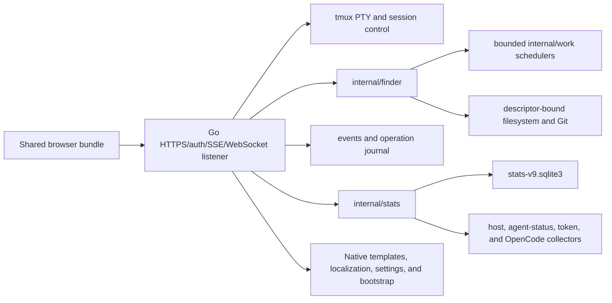

# Backend architecture

This page describes how the Go backend is put together: which process owns what, where data is stored, and the filesystem rules. Routes and capabilities are listed in [Go backend status](../../GO_MIGRATION.md); build and test commands are in [Development](../DEVELOPMENT.md).

## Processes

The backend is a modular monolith. One `yomux-go` process serves everything; it does not start any of the retired Python services (`statsd`, `indexd`, `batchd`, `statusd`, `watchd`, `approvald`) and does not use their RPC protocols.

The `yomux-go` server process owns:

- HTTPS, TLS, authentication, static files, and the page bootstrap.
- tmux discovery, session creation and deletion, and PTY/WebSocket terminal I/O.
- The SSE event broker and the durable operation journal: accepted-operation receipts, acknowledgements, cancellation, and repair after restart.
- Finder and Differ: descriptor-bound filesystem access, Git subprocesses, watches, uploads, and previews.
- Settings, YO!stats, YO!chat, YO!agent (conversations, jobs, watches, skills, reviewed sends), and YO auto-approve.
- Bounded in-process schedulers for interactive Finder work, background refresh, bulk work, and streamed search. A full queue returns a typed busy error.

Finder may start one private native index worker process.

`yomux-go --operator` is the launcher. It plans config and state roots (as captured `unset`/`assign` steps), checks the executable and version, takes a census of listeners, waits for authenticated readiness, discovers sessions, dispatches profiles, and publishes native assets. Explicit profiles keep their own configuration, state, certificates, and ports. An installation records its source checkout separately from the installed files; self-update verifies that checkout, builds the selected revision with native tools, refreshes the same install prefix, and restarts the installed binary.

Runtime JSON lives in `assets/runtime/`. Built-in YO!agent skill and context files are packaged as data. `make build` publishes generated browser assets under the shared checkout writer declaration, and the private-output `tools/staticgen` executable is the Bazel and self-update asset builder.

## Source owners

| Owner | Responsibility |
| --- | --- |
| `cmd/yomux-go/main.go` | Listener, TLS, route registration, tmux PTY/WebSocket, event broker, diagnostics, startup, and shutdown |
| `cmd/yomux-go/auth_config.go`, `auth_runtime.go`, `auth_admission.go` | Auth file parsing, request identity, cookies, and credential admission |
| `cmd/yomux-go/event_operations.go` | Durable event and operation state |
| `cmd/yomux-go/server_lifecycle.go` | Background work ownership and shutdown |
| `cmd/yomux-go/tmux_metadata.go` | Session roster and metadata state |
| `cmd/yomux-go/finder_jobs.go` | Bounded interactive, background, bulk, and streaming Finder admission and completion |
| `cmd/yomux-go/differ_routes.go` | Session-file request identity, persistent cache, and Git-backed Differ data |
| `cmd/yomux-go/settings_native.go` | Settings validation, migration, atomic persistence, pricing history, and writer locking |
| `cmd/yomux-go/stats_runtime.go` | YO!stats routes, collectors, migration, snapshots, deltas, streams, pricing, and readiness |
| `cmd/yomux-go/go_auto_approve.go` | YO enablement, workers, target locks, identity checks, and guarded terminal input |
| `cmd/yomux-go/pages_native.go` and `pages/` | Home, login, and setup templates, escaping, localization, and bootstrap data |
| `cmd/yomux-go/runtime_environment.go` | Command discovery, child environments, and bounded command output |
| `cmd/yomux-go/launch_native.go` | Launch plans, operator probes, profile dispatch, leases, and verified replacement |
| `internal/capabilities` | The capability catalog and typed route policy (roles and capability per method and path) |
| `internal/finder` | Filesystem listing, read, raw, info, watch, search, Git diff/history/commit/blame, mutations, upload, archive, and HTML preview |
| `internal/stats` | SQLite writer and readers, schema, observations, snapshots, rings, host collection, agent status, tokens, pricing, and OpenCode |
| `internal/yolo` | YO rule evaluation and Claude/Codex prompt classification |
| `internal/chat` and `cmd/yomux-go/chat_*.go` | Chat storage, history, presence, questions, events, and HTTP handlers |
| `internal/yoagent` and `cmd/yomux-go/yoagent_*.go` | Agent conversations, skills, jobs, watches, reviewed sends, and CLI transport |
| `internal/tmuxcmd` | tmux socket selection, inherited environment, and locale for server and stats adapters |
| `internal/work` | The bounded worker and queue scheduler |
| `internal/atomicfile`, `internal/tailfile` | Private-state file replacement and bounded transcript record framing |
| `static_src/`, `static/` | Browser source and the generated bundle that Go serves |
| `yomux_lib.web` | Source-only developer renderer and fixture support; not a product server |

## Request handling

- The browser checks `/api/capabilities` before showing backend-dependent features. Unregistered `/api/*` routes return HTTP 501 `feature_unavailable`.
- The route policy in `internal/capabilities` assigns each method and path a role and capability; the catalog supplies current availability. Auth and role checks run before route work.
- Embedded Go templates render the home, login, and setup pages. They share one nonblocking admission slot, a 10-second deadline, and an 8 MiB response limit. Settings and a shared JSON locale registry supply first-paint data.
- Command discovery, authentication probes, and session launches share native `PATH` handling; launches run the resolved absolute path. Git metadata and agent probes have bounded output and cancellation.
- On shutdown the server closes page admission, cancels probes and renders, and waits for them. Every accepted scheduler job, including anonymous jobs, inherits scheduler cancellation. Stats SSE delivery ends on a write or flush failure and releases its demand.
- `cmd/yomux-go/memory_cache.go` is the one server memory budget, `performance.static_cache_mb` (default 64 MB), for gzip-compressed app files and compiled TeX and Office preview PDFs. All kinds share one least-recently-used order; an entry larger than the whole budget is not kept. Hits, misses, evictions, results that could not be cached, bytes, and entries per kind appear under `memory_cache` in `/api/diagnostics/performance`.
- `cmd/yomux-go/static_gzip.go` sends text assets (`.js`, `.css`, `.json`, `.svg`, `.map`) gzip-compressed to browsers that accept gzip; range requests and other files stay uncompressed. Each file version is compressed once and kept in the shared memory cache. A version is the file identity, modification time, and size, so a rebuild that renames a file into place is a new version even when size and time match. Compression checks the open file and the path before and after reading, and refuses bytes from a file that changed meanwhile. A compressed response names the asset type itself (`.map` is `application/json`), states its exact compressed `Content-Length`, carries its own ETag ending in `-gzip`, and does not advertise byte ranges, because ranges are served only from the plain file. Startup warm-up runs as tracked background work, skips hidden build temporaries, and only fills free budget; it never evicts a file a browser already asked for.
- `cmd/yomux-go/tex_preview_cache.go` reuses a compiled TeX preview, with its SyncTeX page map, only while every input is unchanged. The key covers the compiler kind and binary identity, the source the browser sent, and the document directory. The compiler reports the document files it read: Tectonic through `--makefile-rules`, pdfLaTeX through `-recorder`. Each input and its directory are recorded by identity, size, nanosecond modification time, and change time, and files also by SHA-256. A lookup restats every input and rehashes a file whose stat fields moved; any difference, or a new file in a recorded directory, compiles again. Files from the shared TeX package cache are not tracked. A compile whose inputs the compiler cannot report, with an input that changed during the compile or less than two seconds before it started, or that failed is not cached. Requests that waited for the compiler look again before compiling, so identical concurrent requests compile once. The shared-document compile uses the same cache. A response says `X-YOmux-Preview-Cache: hit` or `miss`.
- Office previews are cached by the SHA-256 of the document bytes, its extension, and the identity of the installed LibreOffice program files. Only successful conversions are cached.
- Periodic and status-triggered update checks run under the tracked background-work owner and its cancellation context. Shutdown waits for their build processes before releasing instance ownership. Readers of update readiness do not hold the checker mutex; the next check waits for publication to finish.

## YO auto-approve

`cmd/yomux-go/go_auto_approve.go` owns persisted YO enablement, worker lifecycle, shared target locks, tmux and agent-process identity checks, and guarded terminal input. `internal/yolo` evaluates rules and classifies Claude and Codex prompts. Workers use fresh agent-status snapshots and visible pane captures; stale evidence suspends input. Codex capacity recovery repeats only while the exact current notice is visible.

## Storage roots

| Root | Contents | Sharing rule |
| --- | --- | --- |
| Config directory (`YOMUX_CONFIG_DIR`, default `~/.config/yomux`) | `auth.yaml`, `settings.yaml`, event and operation journals (`go-events.jsonl`, `go-operations.json`, `go-operations.jsonl`), background-owner records, the `go-storage.lock` lease, and the default stats database `stats-v9.sqlite3` | One private local directory per instance. |
| State directory (`YOMUX_STATE_DIR`, default `~/.local/state/yomux`, or `$YOMUX_ROOT/state`) | Session-files cache, credential admission (`go-login-rate.sqlite3`), and native chat and agent state | One private local directory per instance. Never share live SQLite databases between hosts. |
| Writable checkout | Source, the selected binary, and generated browser assets | Separate worktrees. The checkout writer declaration coordinates writers on one host. |

- `go-storage.lock` is a lease held until process exit, so final HTTP, collector, and health writes cannot race a replacement process. Do not unlink a held lock.
- The config directory, journals, and the auth and stats WAL databases must pass a local-filesystem probe on Linux and macOS before they accept writes; unknown or failed probes refuse. `YOMUX_ALLOW_NETWORK_FILESYSTEM_MUTABLE_ROOTS=1` is a warning-producing emergency override; it does not make WAL on NFS safe (see SQLite's [WAL overview](https://www.sqlite.org/wal.html#overview)). Source checkouts may live on NFS when the mutable roots are local.
- Go reads `YOMUX_CONFIG_DIR`, `YOMUX_STATE_DIR`, `YOMUX_ROOT`, and `YOMUX_STATS_DATABASE`. It does not implement Python's `YOMUX_RUNTIME_DIR`/`YOMUX_CACHE_DIR` service layout or automatic host partitioning. The native chat store keeps a host-partitioned path inside the state root; that does not make network sharing safe.
- Retiring Python removed code, not data. Keep existing databases, configuration, backups, caches, user skills, and agent configuration. Never move a database or copy its WAL/SHM files separately while a writer runs. A deliberate migration needs a consistent backup, stopped source and destination owners, and a tested restore.
- Private-state files are replaced through `internal/atomicfile`: a unique mode-0600 staging file is written, synced, and closed before it is published. Session-file cache publication keeps its generation check around the final rename.

## Settings

`cmd/yomux-go/settings_native.go` validates, migrates, and atomically writes `settings.yaml`, and keeps effective-dated pricing history, both for HTTP requests and at startup. Defaults, choices, limits, descriptions, and migration values live in `assets/runtime/settings-schema.json`, which the retained Python tooling also reads. Writers take the adjacent POSIX record lock so independent processes keep each other's changes, and Go also serializes writers in-process. Malformed YAML is kept and reported; it does not replace the last valid Finder index policy. The settings contract is tested with fixed baseline fixtures, writes and restart reconciliation without Python on `PATH`, pricing history, concurrent patches, and lock contention. Cross-host locking and macOS runtime acceptance are separate rollout checks.

## Credentials

Password checks go through one admission path for form login, Basic authentication, and WebSocket authentication. Its state is `go-login-rate.sqlite3` in the state directory (the config directory if no state directory is set), separate from YO!stats, with HMAC identifiers keyed by `go-login-rate-secret`.

- Atomic SQLite transactions coordinate processes that use the same state root. Limits: 32 verifications in flight, two-minute expiry for abandoned claims, and at most 50,000 rows. Expiry does not refund network charges.
- Unknown usernames, including their hard locks, expire after six idle hours without an active claim. Hard locks on configured accounts persist; other usernames expire after six idle hours once their cooldown and claims end.
- Policy overrides are read from `login-rate-limit.json` in the config directory at first credential use; restart after changing them. Invalid overrides keep the defaults.
- If admission storage is unavailable, login fails closed before any password hashing.
- Cookie and limiter secrets are published completely and never replaced. Login cookies use a port-specific name and last 90 days; a password change invalidates that account's cookies.
- The Python recovery CLI, throttle diagnostics, login decoys, and firewall escalation are retired.

## Finder and Differ

### Filesystem boundary

Finder accepts any absolute path the server process can access. It does not use Python's configured-root allowlist or credential-name denylist. The boundary is OS permissions plus descriptor identity checks, bounded reads, walks, and results, the user's role, and a guard against changing the product's own roots. Symlink and namespace-sensitive operations revalidate descriptor identities before use; the code documents the remaining same-UID basename race on systems without a conditional namespace syscall.

Linux uses inotify with bounded reconciliation, read through `Poll` so descriptors above 1023 work; other platforms poll the filesystem.

Finder's fast listing returns names without Git enrichment, so the browser can paint a directory first and add Git status later. Differ history works the same way: commit rows load first, and `stats=1` fills in line counts. Expanding a commit uses one bounded Git path for metadata, file status and counts, and diff content.

TextEdit and ViewEdit use the shared browser code and the Finder read, write, raw, upload, and preview routes; there is no separate editor service.

### Quick Open index

Quick Open uses a private SQLite filename index; file contents are never indexed. Directory ancestry is shared across overlapping roots. Dependency, cache, secret, VCS, build, native executable, object, library, and bytecode entries are excluded from the index; Finder still lists them.

| Setting | Default | Meaning |
| --- | --- | --- |
| `file_explorer.index_persist` | `true` | Keep the index on disk. Turning it off switches to memory without deleting disk snapshots or rollback files. |
| `file_explorer.index_persist_max_mb` | `1024` | Budget for the active database plus WAL across all roots. Replacement may use up to 2048 MiB transiently; retained rollback files are reported separately. |
| `file_explorer.index_refresh_seconds` | `60` | Refresh interval for visible roots. `0` disables periodic refresh. |
| `file_explorer.index_background_refresh_seconds` | `900` | Refresh interval for hidden roots. `0` disables periodic refresh. |

- Persisted indexes load without crawling every root at startup. Searches keep cached results, and their refresh ownership, when panels hide.
- A replacement that does not fit the budget keeps the previous searchable generation and reports the blocked refresh; a cold root may publish measured partial coverage. Lowering the budget can leave data over the new limit until a compliant replacement succeeds. Rejected replacements clean up their own unpublished staging files.
- Changes to budgets, file limits, and refresh intervals keep compatible results. Root and exclusion changes fence affected results until acknowledged. Malformed YAML keeps the last valid configuration. Index status reports revisions, coverage, sync errors, and storage use.
- Schema 2 migration copies supported records into a private candidate, validates records and relationships, checkpoints the original, and keeps a uniquely named same-filesystem rollback link before atomic publication. Publication phases are recorded next to the database. Interrupted candidates and rollback databases are kept for inspection; do not delete them during normal restarts or persistence changes. Newer schemas are rejected by a read-only header and WAL probe before SQLite can create sidecar files. Refresh candidates use measured allocation and bounded checkpoints; failed candidates count toward later transient admission. Reclamation removes only unused directory leaves, in bounded SQLite batches.

### Differ attribution index

Differ keeps file attribution in a private SQLite index (`attribution/attribution.sqlite3`) inside the session-files cache directory under the state root. Requests read prepared history and queue background catch-up instead of scanning transcript archives; saved results stay visible during refresh, and incomplete preparation shows "Indexing history." The index stores normalized file operations and progress, never transcript bodies or shell commands. Stats and attribution keep independent durable positions through one shared in-process transcript reader.

## YO!stats

YO!stats writes `stats-v9.sqlite3` directly and owns its writer lock. Schema upgrades and rollback are described in [Go backend status](../../GO_MIGRATION.md#yostats).

- Host CPU, memory, and mounted-filesystem usage, process CPU and RSS, agent inventory, and daemon CPU and RSS are collected on Linux and macOS. macOS uses Mach host counters and libproc. Other systems report these as unavailable. New samples use the normal cadence; older gaps stay unavailable.
- Disk usage is collected every five minutes, with stable source IDs from the exact mountpoint bytes. Healthy rows survive partial `df` failures, invalid samples become unavailable spans, and collector errors are counted.
- Collector health is reported in `stats_runtime.collector_health` on the authenticated system status and in retained `stats_collector_health` events on the core client stream: attempt and commit times, consecutive failures, rejected and dropped counts, queue depth, and first and latest errors with opaque source IDs. Host collector families recover independently.
- Retention deletes expired facts and epochs without rewriting retained epoch starts; readers limit coverage to the requested window. A restart creates new epochs and keeps existing gaps.
- Browser observations: validation errors and identity conflicts are permanent request errors. Storage failures return a retryable HTTP 503; the browser keeps the payload and retries with the same observation identities, and the retry acknowledges accepted or already-recorded observations.

### Transcript reading

`internal/tailfile` frames transcript records with bounded reads and reuses incomplete bytes only within the same file snapshot. If the snapshot changes, it rereads the unfinished record from the last complete boundary, so rewrites in the middle of a file are handled within the per-poll byte and record limits; a growing unfinished record can need extra reads. Complete records already read stay cached across appends: a changed snapshot keeps them only when the file grew and 4 KiB samples at its start and before the last complete-record boundary still match the cached bytes; truncation, replacement, same-size changes, and sample mismatches drop every cached byte of the file. A rewrite confined to earlier complete records is not detected, which matches the checks consumer positions already rely on. Claude path lookup advances a bounded discovery cursor across requests using the same traversal as token discovery; transcript attribution stays separate. Attribution admits a cycle at 4 MiB and 4,096 records. Each admitted source gets enough budget to finish or reject one frame up to the shared 8 MiB limit; counting actual reads, including failed ones, caps a cycle at 12.25 MiB without limiting it to one source.
