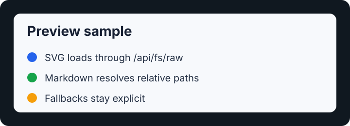
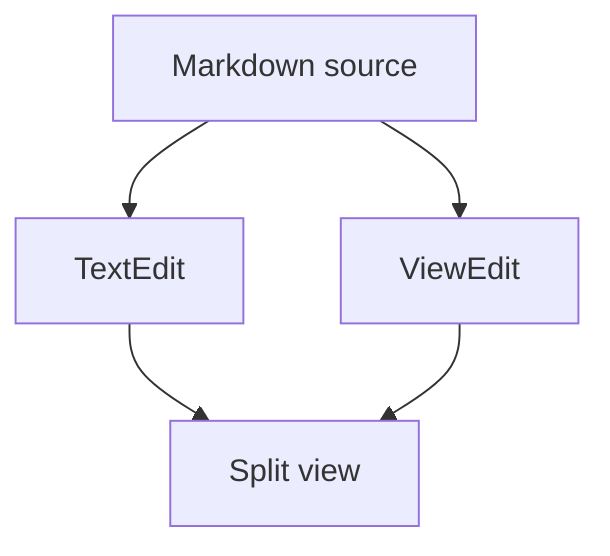
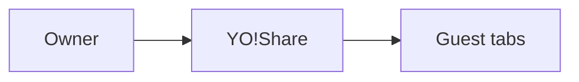

# YOmux Markdown Example

Open this file in **View** to edit the rendered text. Use **Split** to watch ViewEdit and TextEdit update together. This is a practice page for the same Markdown you can use in a terminal workspace or share with a guest.

> Keep commands in a code block, decisions in a table, and next steps in a checklist.

## Try a workspace handoff

1. Open a terminal and a Markdown tab in the same workspace.
   - Use the terminal to run commands.
   - Use the Markdown tab to record results.
2. Open **File → YO!Share → New Share** to invite a guest to selected tabs.

- [ ] Toggle this task in ViewEdit.
- [x] Open the sample in YOmux.
- [ ] Try editing a table cell.

### Format a line

This line has <strong>bold</strong>, <em>italic</em>, <s>strikethrough</s>, and `inline code`. Select a word and try changing its formatting in ViewEdit.

This is the first rendered line.\
This is the second rendered line.

## Workspace notes

| Surface | What to try | Example |
| :--- | :--- | ---: |
| TextEdit | Edit Markdown source and watch the preview | <strong>`bold`</strong> |
| ViewEdit | Add a table row with the right-click menu | 1 |
| Split | Click an image to highlight its markup in TextEdit | 2 |

## Local images

Both images use Markdown syntax. The second tests a relative path with spaces.




## Diagrams and math





Inline math fits into prose, as in $a^2 + b^2 = c^2$. Display math gets its own block.

$$
\sum_{n=1}^{4} n = 10
$$

## Code and links

```js
const workspace = {terminal: "shell", notes: "03-md-mixed.md"};
console.log(workspace.notes);
```

- [YOmux HTML example](./11-html.html)
- [Notes with parentheses in the filename](./24-notes\(2026\).md)
- [External link example](https://example.com/)

For a companion file with inline HTML, sized images, and collapsible sections, open the [rich HTML example](./04-md-rich.md).

---

## Missing image

This intentionally missing image exercises the unavailable-image state.


