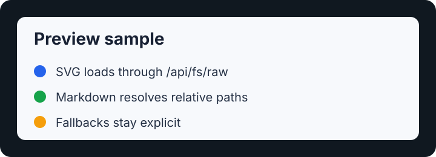

# YOmux Rich HTML in Markdown

Open this example in YOmux **View** to edit the prose, or choose **Split** to see the HTML embedded in its Markdown source. The [companion Markdown example](./03-md-mixed.md) covers the same workspace without raw HTML.

## Inline HTML in an editing guide

Use <kbd>Ctrl</kbd>+<kbd>F</kbd> to find text. Mark an important word with <mark>highlight</mark>, and use <u>underline</u> for emphasis when bold is already in use.

HTML styles can be nested. This example combines <strong>strong text with <em>emphasis inside it</em></strong> and marks an old instruction as <s>superseded</s>. An exponent can use HTML, as in 2<sup>8</sup> = 256. Use <code>git status --short</code> for a literal command.

A single paragraph can contain controlled breaks.<br>
This line starts after one break.<br>
This line starts after the second break.

## Collapsible sections

<details>
<summary>Open a YOmux workspace</summary>

1. Open a **Terminal** tab and a Markdown document.
2. Select **Split** and edit this sentence to see the source update.
3. Use <mark>YO!Share</mark> when a guest needs access to selected tabs.

> A collapsible section can contain normal Markdown. The HTML tags define the container.

</details>

<details>
<summary>Compare two embedded SVG images</summary>

The status card has an HTML width and title. In Split, click the rendered card to highlight the tag that produced it.



This second HTML image uses a path with spaces and a different width.


</details>

## HTML as source

Use a fenced code block to show literal HTML. This snippet is displayed as code.

```html
<details>
  <summary>Workspace note</summary>
  <p>Read the <mark>highlighted</mark> setup step.</p>
</details>
```

For a standalone document with page-level HTML, CSS, and JavaScript, open the [YOmux HTML example](./11-html.html).
